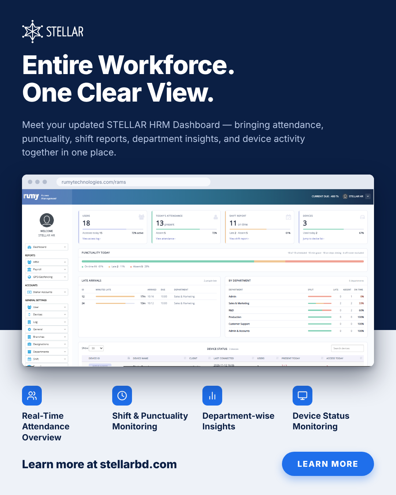

<div align="center">


<a href="https://stellarbd.com/"></a>

<br />

<a href="https://stellarbd.com/"></a>
<a href="https://www.facebook.com/stlrbd"></a>
<a href="https://wa.me/8801810030760"></a>

</div>


## Templates

<table>
  <tr>
    <td align="center" width="33%">
      <a href="stellar-hrm-dashboard-update-html-email.html">
        
      </a>
      <br /><b>HRM Dashboard Update</b>
      <br /><sub>Product update · Nov 2026</sub>
    </td>
    <td align="center" width="33%">
      <sub><i>Next template</i></sub>
    </td>
    <td align="center" width="33%">
      <sub><i>Next template</i></sub>
    </td>
  </tr>
</table>


## Files

| File | Purpose |
|:--|:--|
| `STELLAR Logo name beside.png` | Logo, shared by all templates |
| `readme-header.svg` | Animated header for this README |
| `stellar-hrm-dashboard-update-html-email.html` | HRM Dashboard Update email |
| `stellar-hrm-dashboard-update.png` | Hero image for that email |


## Add a new template

Each template is a pair of files with the same name:

```
<template-name>-html-email.html     the email
<template-name>.png                 its hero image (also the preview above)
```

1. Copy `stellar-hrm-dashboard-update-html-email.html` and rename it, e.g. `stellar-year-end-offer-html-email.html`.
2. Upload its hero image with the matching name, e.g. `stellar-year-end-offer.png`.
3. In the new HTML, update the content, links and the hero image URL.
4. Add a cell for it to the **Templates** table above, and a row to **Files**.
5. Send yourself a test before using it in a campaign.


## Image links

Emails need direct image URLs, so use GitHub's raw format:

```
https://raw.githubusercontent.com/MSSohan/HTML-email-template-for-Stellar/main/<file-name>
```

Spaces in file names must be written as `%20`, e.g. `STELLAR%20Logo%20name%20beside.png`. Social icons load from [Icons8](https://icons8.com/).

> [!IMPORTANT]
> Keep this repository **public** and never rename or delete an image a sent email uses. Emails already in inboxes still load it from here.


## Sending with Sender

Create a campaign → choose the **HTML editor** → paste the template's HTML → replace `{{unsubscribe_link}}` with Sender's unsubscribe tag → send a test → send.


## Brand

| | Colour | Use |
|:-:|:--|:--|
|  | `#0B1F44` | Headings, footer |
|  | `#1F6FEB` | Primary button |
|  | `#128C7E` | WhatsApp button |
|  | `#1877F2` | Facebook button |
|  | `#EEF2F8` | Background |

**Font:** Segoe UI, Roboto, Helvetica, Arial, sans-serif

<br />

<div align="center">

<sub>© STELLAR · 1005/2/1872 CDA Avenue, East Nasirabad, Chattogram · 01810030762</sub>
</div>
